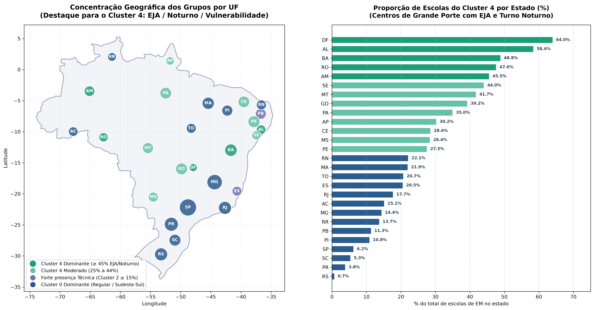
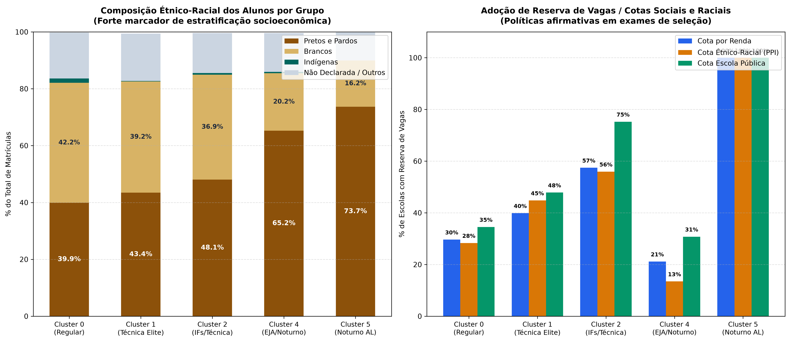
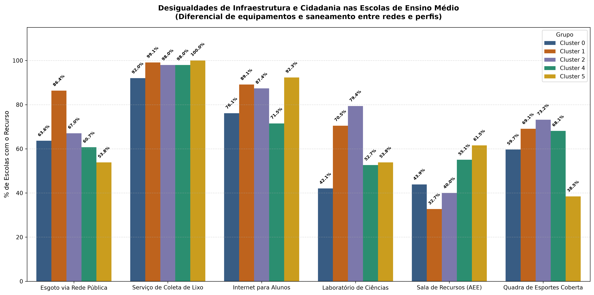
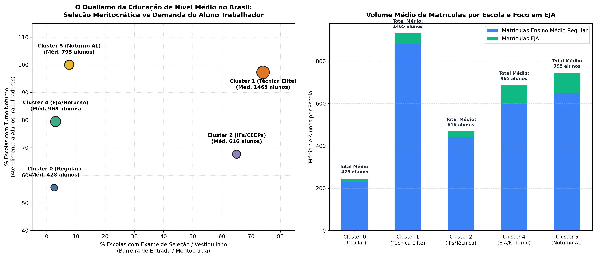

# 📊 Análise de Clusters e Estratificação Socioeconômica — Censo Escolar 2024

> **Relatório Analítico & Diagnóstico Socioeconômico**  
> Referência técnica: `dicionário_dados_educação_básica.xlsx` (Censo Escolar da Educação Básica 2024 — INEP/MEC).  
> Amostra total: **21.092 escolas de Ensino Médio**, segmentadas em **6 clusters**.

---

## 📌 Sumário Executivo & Diagnóstico Socioeconômico

A análise dos microdados revela que a segmentação das escolas de Ensino Médio no Brasil reflete não apenas opções pedagógicas ou administrativas, mas **fraturas socioeconômicas, raciais e regionais estruturais**:

1. **A Fratura Geográfica Norte/Nordeste vs. Sul/Sudeste:**  
   Enquanto o Sul e o Sudeste concentram escolas no modelo regular de tempo integral ou diurno (Cluster 0: 75% a 93% da rede), estados do Norte, Nordeste e Centro-Oeste possuem até **64%** de suas escolas classificadas no **Cluster 4** — caracterizadas por grande porte, forte presença de EJA, turnos noturnos e atendimento a alunos trabalhadores em situação de vulnerabilidade.
2. **Estratificação Étnico-Racial e Renda:**  
   A proporção de alunos **pretos e pardos** salta de **39,9% no Cluster 0** e **43,4% no Cluster 1** para **65,2% no Cluster 4** e estarrecedores **73,7% no Cluster 5**. O turno da noite e a EJA funcionam como os principais amortecedores da vulnerabilidade socioeconômica na educação básica.
3. **Dualismo Estrutural: Acesso Aberto vs. Barreira Meritocrática:**  
   As escolas técnicas de ponta (Clusters 1 e 2) concentram os melhores índices de laboratórios, bibliotecas e infraestrutura, mas impõem barreiras de entrada (**65% a 74% exigem vestibulinho/exame de seleção**), enquanto as escolas de massa absorvem toda a demanda sem filtros, sofrendo com menor densidade de laboratórios científicos e desafios de saneamento básico.

---

## 🗺️ 1. Mapa do Brasil: Localização e Predominância dos Grupos

O mapa abaixo ilustra a distribuição geográfica e a intensidade da presença do **Cluster 4 (Centros de Grande Porte / EJA / Turno Noturno)** em comparação com os modelos regulares e técnicos.

### 🔍 Destaques e Interpretação Geográfica:
* **Estados com maior concentração de Cluster 4:**  
  * **Distrito Federal (DF):** 64,0% das escolas
  * **Alagoas (AL):** 58,4% (+ 4,7% de Cluster 5 = 63,1% noturno)
  * **Bahia (BA):** 48,8%
  * **Rondônia (RO):** 47,6%
  * **Amazonas (AM):** 45,5%
  * **Sergipe (SE):** 44,0%
* **O Contraste do Sul/Sudeste:**  
  * No **Rio Grande do Sul (RS)**, o Cluster 4 representa apenas **0,7%** das escolas; em **Santa Catarina (SC)**, **5,3%**; no **Paraná (PR)**, **3,8%**; e em **São Paulo (SP)**, **6,2%**.
  * Nestes estados, o **Cluster 0** (ensino regular padrão diurno) atende entre **85% e 93%** das instituições de Ensino Médio.
* **Os Polos da Educação Técnica (Cluster 2):**  
  * Destacam-se o **Ceará (21,0%)**, o **Espírito Santo (23,1%)** e a **Paraíba (16,1%)**, refletindo redes estaduais fortemente articuladas com Centros Estaduais de Educação Profissional (EEEPs) e campi dos Institutos Federais (IFs).

---

## 🧑‍🤝‍🧑 2. Perfil Socioeconômico e Composição Racial dos Alunos

A análise das variáveis `QT_MAT_BAS_BRANCA`, `QT_MAT_BAS_PRETA`, `QT_MAT_BAS_PARDA` e das políticas afirmativas (`IN_RESERVA_RENDA`, `IN_RESERVA_PPI`, `IN_RESERVA_PUBLICA`) evidencia a estratificação socioeconômica direta entre os agrupamentos.

### 📊 Comparativo Socioeconômico e Étnico-Racial:

| Indicador Socioeconômico | Cluster 0 (Regular) | Cluster 1 (Elite Técnica) | Cluster 2 (IFs/Técnica) | Cluster 4 (EJA/Noturno) | Cluster 5 (Noturno AL) |
|---|---|---|---|---|---|
| **Alunos Pretos e Pardos** | 39,9% | 43,4% | 48,1% | **65,2%** | **73,7%** |
| **Alunos Brancos** | 42,2% | 39,2% | 36,9% | 20,2% | 16,2% |
| **Alunos Indígenas** | 1,6% | 0,2% | 0,6% | 0,5% | 0,0% |
| **Cota por Renda (%)** | 29,6% | 39,9% | **57,4%** | 21,2% | 100,0% |
| **Cota PPI (%)** | 28,3% | 44,8% | **55,9%** | 13,5% | 100,0% |
| **Cota Escola Pública (%)** | 34,5% | 47,9% | **75,2%** | 30,8% | 100,0% |

### 💡 Conclusões Analíticas:
* **Forte sobreposição entre Raça e Vulnerabilidade:** As escolas com turmas noturnas e EJA (Clusters 4 e 5) atendem uma população predominantemente negra e parda (mais de 65% a 73%), espelhando a histórica inserção precoce de jovens pretos e pardos no mercado de trabalho informal para complementação de renda familiar.
* **A Lei de Cotas nos Institutos Federais (Cluster 2):** O Cluster 2 apresenta a maior taxa de aplicação de cotas para escola pública (75,2%) e cotas de renda (57,4%), demonstrando o impacto direto da legislação federal (Lei nº 12.711/2012) na democratização de escolas com alto investimento público.

---

## 🏛️ 3. O Hiato de Infraestrutura e Cidadania Básica

A infraestrutura escolar é um dos indicadores mais sensíveis de disparidade socioeconômica territorial. Escolas em comunidades vulneráveis e periféricas frequentemente operam sem serviços públicos essenciais de saneamento e tecnologia.

### 📈 Indicadores Críticos de Infraestrutura (% das Escolas):

| Recurso / Equipamento | Cluster 0 (Regular) | Cluster 1 (Elite Técnica) | Cluster 2 (IFs/Técnica) | Cluster 4 (EJA/Noturno) | Cluster 5 (Noturno AL) |
|---|---|---|---|---|---|
| **Rede Pública de Esgoto** | 63,6% | **86,4%** | 67,0% | 60,7% | 53,8% |
| **Coleta Regular de Lixo** | 92,0% | **99,1%** | 98,0% | 98,0% | 100,0% |
| **Queima Lixo no Terreno** | **7,6%** | 0,0% | 1,5% | 2,0% | 0,0% |
| **Internet para Alunos** | 76,1% | **89,1%** | 87,4% | 71,5% | **92,3%** |
| **Laboratório de Ciências** | 42,1% | 70,5% | **79,4%** | 52,7% | 53,8% |
| **Laboratório de Informática** | 71,2% | **93,6%** | **94,3%** | 71,3% | 92,3% |
| **Sala de Recursos (AEE)** | 43,9% | 32,7% | 40,0% | 55,1% | **61,5%** |

### ⚠️ Pontos de Alerta:
* **7,6% das escolas regulares (Cluster 0) queimam lixo no próprio terreno:** Este indicador reflete a ausência de coleta pública em áreas rurais e periféricas de cidades do interior, impactando diretamente a saúde de alunos e comunidades.
* **O fosso laboratorial:** Enquanto quase **80%** das escolas do Cluster 2 possuem Laboratório de Ciências e **94%** têm Laboratório de Informática, menos da metade das escolas estaduais regulares (42,1%) dispõe de espaço adequado para aulas práticas de química, física ou biologia.
* **O avanço do AEE nas escolas de massa:** O Cluster 4 (55,1%) e o Cluster 5 (61,5%) possuem maior cobertura de Salas de Atendimento Educacional Especializado (AEE) que os clusters de elite técnica (32,7%), evidenciando seu papel como polos acolhedores de inclusão social.

---

## ⚖️ 4. O Dualismo Educacional: Meritocracia vs. Inclusão do Trabalhador

O Ensino Médio brasileiro é marcado por um dualismo histórico: de um lado, redes técnicas seletivas voltadas para a formação especializada ou ingresso em universidades públicas; de outro, redes estaduais de massa que acolhem os jovens que trabalham durante o dia.

### 📌 Comparação de Paradigmas:

1. **O Polo da Seletividade Meritocrática (Clusters 1 e 2):**
   * **74,1%** das escolas do Cluster 1 e **65,0%** do Cluster 2 utilizam exames de seleção (vestibulinho).
   * Menor proporção de EJA (apenas matrículas residuais) e turno noturno voltado apenas a cursos técnicos pós-médio subsequentes.
   * Custo por aluno e equipamentos proporcionalmente mais elevados.
2. **O Polo do Acolhimento Social e do Aluno Trabalhador (Clusters 4 e 5):**
   * **79,5% a 100% de funcionamento noturno**.
   * Quase **62%** das escolas do Cluster 4 ofertam Educação de Jovens e Adultos (EJA), com média de 89 matrículas de EJA por escola.
   * Sem barreiras meritocráticas de entrada (exame de seleção em apenas 3% das unidades).
   * **Porte massivo:** Escolas do Cluster 4 atendem, em média, **965 alunos**, exigindo forte capacidade de gestão e suporte socioemocional.

---

## 📁 Síntese Geral dos 6 Clusters

| Cluster | N Escolas | % Amostra | Perfil Síntese | Região Predominante | Característica Socioeconômica Central |
|---|---|---|---|---|---|
| **Cluster 0** | 15.418 | 73,1% | Escola Estadual Regular de EM | Sudeste e Sul | Média de 428 alunos, infraestrutura básica intermediária, 18% rural. |
| **Cluster 1** | 220 | 1,0% | Instituto Técnico de Excelência | Sudeste (SP) e NE (BA) | Megacomplexos (média 1.465 alunos), 74% seleção, 100% Ed. Profissional. |
| **Cluster 2** | 1.444 | 6,8% | Rede Técnica Federal e CEEPs | Nordeste e Sudeste | 100% profissional, 65% seleção, 75% cotas para escola pública. |
| **Cluster 3** | 1 | 0,005% | Outlier Municipal (Poção de Pedras - MA) | Maranhão (MA) | Escola municipal que acumula EM, EJA e Ed. Profissional, fossa e poço. |
| **Cluster 4** | 3.996 | 18,9% | Grandes Centros Estaduais com EJA | Nordeste, Norte e CO | 65% alunos pretos/pardos, 80% noturno, 62% EJA, alta vulnerabilidade. |
| **Cluster 5** | 13 | 0,1% | Escolas Noturnas de Alagoas | Alagoas (12) + SP (1) | 100% noturnas, 74% pretos/pardos, 100% cotas sociais, médio/grande porte. |

---

## 🛠️ Metodologia e Arquivos

* **Microdados Originais:** Microdados da Educação Básica 2024 — INEP (Tabela de Escolas).
* **Referência de Variáveis:** `dicionário_dados_educação_básica.xlsx` (planilha `microdados_unidade_coleta`, 426 colunas mapeadas).
* **Imagens e Gráficos:** Armazenados na pasta local [images/](file:///c:/Users/User/Desktop/clusters/images/) em alta resolução (300 DPI).
* **Scripts de Reprodução:** Disponíveis no diretório scratch do sistema (`generate_graphs.py`, `analyze_clusters.py`).
